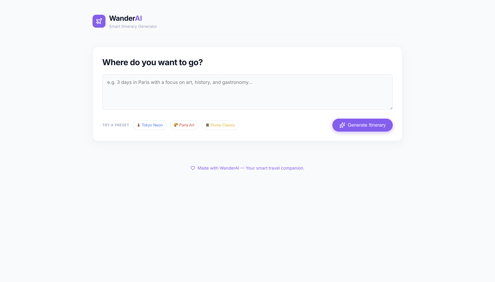
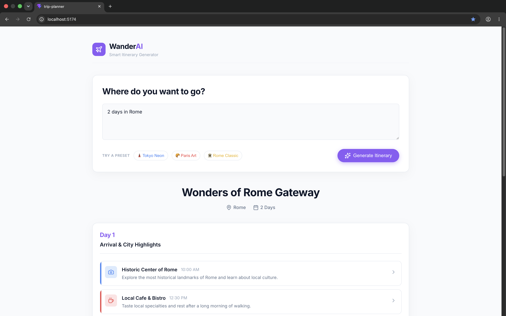
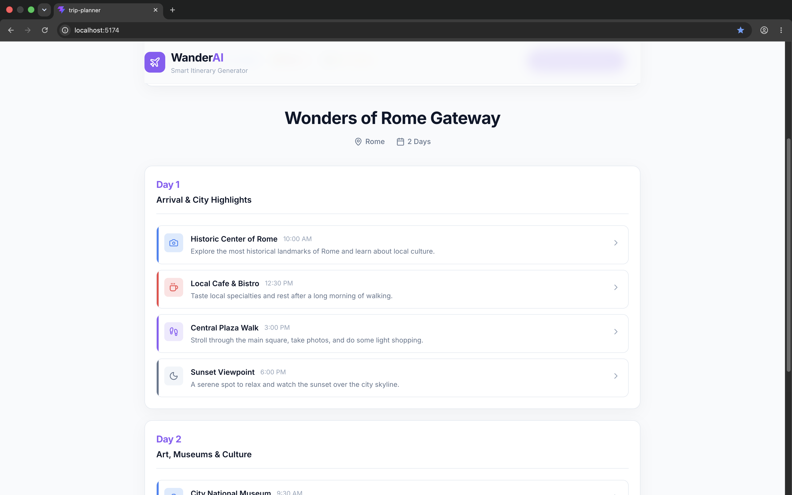
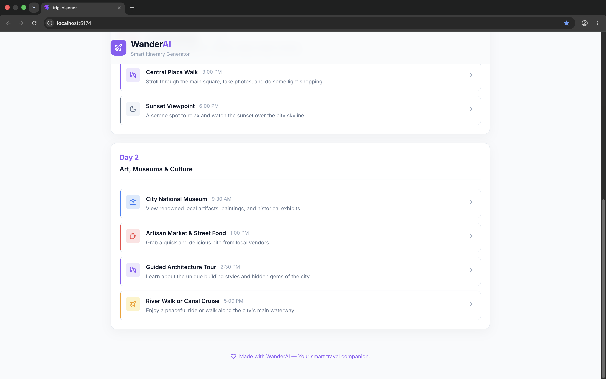
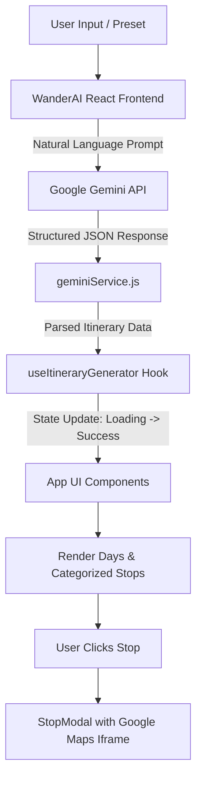

# WanderAI - Smart Itinerary Generator

WanderAI is an intelligent, premium SaaS-style itinerary generator powered by Google's Gemini AI. It creates beautifully structured, day-by-day travel plans based on natural language prompts.

## 📸 Screenshots

| Dashboard | Generated Itinerary |
| :---: | :---: |
|  |  |

| Stop Details | Map Modal |
| :---: | :---: |
|  |  |

## 🏗️ Working Diagram



## 🚀 Setup

1. **Clone the repository:**
   ```bash
   git clone https://github.com/aashutosh-k-das/Tripe-Planner.git
   cd "Trip Planner"
   ```

2. **Install dependencies:**
   ```bash
   npm install
   ```

3. **Configure Environment:**
   You can run the app without an API key: it uses the built-in recommendation engine and curated itineraries. To use live AI, get a free key from [Google AI Studio](https://aistudio.google.com/apikey):
   ```bash
   cp .env.example .env
   # then set VITE_GEMINI_API_KEY in .env
   ```
   `.env` is git-ignored so your key is never committed.

4. **Run the development server:**
   ```bash
   npm run dev
   ```

## 💡 Usage

1. Open the application in your browser (usually `http://localhost:5173`).
2. Type your travel destination and preferences into the input box (e.g., "3 days in Paris with a focus on art and food") or select a quick Preset.
3. Click **Generate Itinerary**.
4. Browse your beautifully formatted, day-by-day itinerary with categorized stops.
5. Click on any specific stop to open a modal with more details and an interactive Google Map of the location.
6. Or scroll down to **Discover Incredible India** and pick a curated trip by region and Indian area, or search by city/country.
7. Check **Getting there** to compare flight, train and road from your city. Pick it from the list, or write it in your request (e.g. "Mumbai to Goa").
8. Check the **Estimated budget** card for a trip total (and per-day totals on each day card), parsed from each stop's cost estimate.
9. Tick the circle on a stop to mark it **visited** — progress is tracked per day and for the whole trip, and saved with the trip in **My Trips**.
10. Use the **category chips** (Food, Sightseeing, Transport…) to filter stops.
11. Pick a start date and click **Add to Calendar** to download an `.ics` file you can import into Google Calendar, Apple Calendar or Outlook.
12. Manage saved trips from **My Trips** — delete individual trips or clear them all.

## 🤖 AI-Usage Note

- **Chat assistant ("Ask AI" button)**: A floating chatbot that answers travel questions in a conversation: where to go, which place is better, how to reach a place by flight, train or road, the best time and live weather, trip cost, what to pack, and "plan 3 days in Goa", which builds the itinerary on the page. It remembers the place you're discussing and knows which trip is open. With a Gemini key it's a real multi-turn Gemini chat, grounded in the app's destination list (`src/ChatBot.jsx`). Without a key, or if the API fails, a built-in assistant answers from the app's own data (`src/chatAssistant.js`).

- **AI Trip Advisor ("Help me choose")**: Ask in plain words, e.g. *"Goa or Kerala for a honeymoon in December?"*, or set your city, month, days, budget, group and interests. WanderAI ranks the destinations and shows the top 3 picks with match %, reasons, watch-outs and a side-by-side comparison (`src/advisor.js`). The scoring uses season, interests, budget, travel time and trip length. With a Gemini key, Gemini re-ranks those candidates and writes the advice. It can only pick from the app's destinations and facts, which keeps it from inventing places. Without a key, or if the API fails, the built-in engine writes the verdict.

This project leverages the **Google Gemini API** (`@google/generative-ai`) to transform natural language into highly structured JSON data. 
- **Prompt Engineering**: The application uses a strictly defined JSON schema in its system prompt to ensure the AI always returns parseable, consistent data (days, stops, categories, times, and map search queries).
- **Fallback Mode**: Without an API key, the app uses a library of hand-curated itineraries for **43 destinations in 22 countries** (`src/destinations.js`), with a focus on India: 22 Indian trips grouped by area (North, Himalayas, West, South, East & Northeast, Islands), plus Nepal, Bhutan, Sri Lanka, the Maldives and popular international cities. Indian and Nepali trips are priced in ₹ and NPR. Any other destination gets a generic template plan.
- **Getting There**: Every trip shows how to reach it **by flight, train and road** (and sea, for islands) from 17 Indian cities, with the nearest airport and railhead, route tips, the best time to visit, and *Fastest* / *Budget pick* recommendations (`src/travelInfo.js`). Door-to-door times are distance-based estimates; trips outside the library are geocoded so they still get estimates.

## ⚠️ Limitations

- **Map Accuracy**: The embedded Google Maps use a generic search query based on the AI-generated location name. For highly specific or obscure places, the map might occasionally default to a general city view.
- **AI Hallucinations**: As with all LLMs, Gemini may occasionally suggest places that are permanently closed, or hallucinate travel times between locations.
- **Client-Side API Key**: Currently, the Gemini API key is loaded on the client side via `.env` for demonstration purposes. In a real-world production environment, this logic should be moved to a secure backend endpoint to prevent exposing the API key to the public.

## ⏱️ Time Spent

- **UI/UX Design & CSS Styling**: ~2 hours
- **React Component Architecture & State Management**: ~1.5 hours
- **Gemini AI Integration & Prompt Engineering**: ~1 hour
- **Total Estimated Time**: ~4.5 hours
